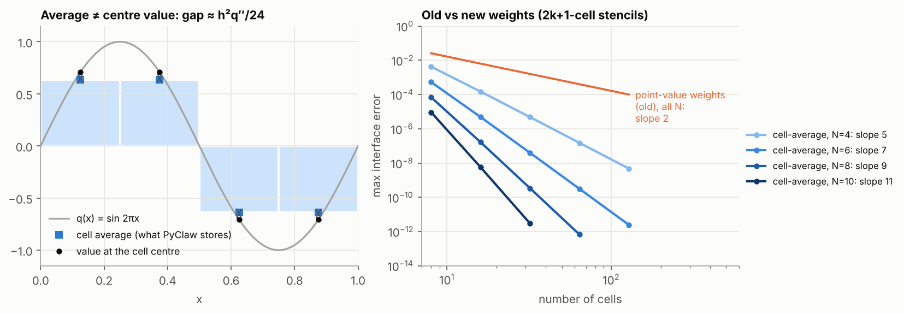
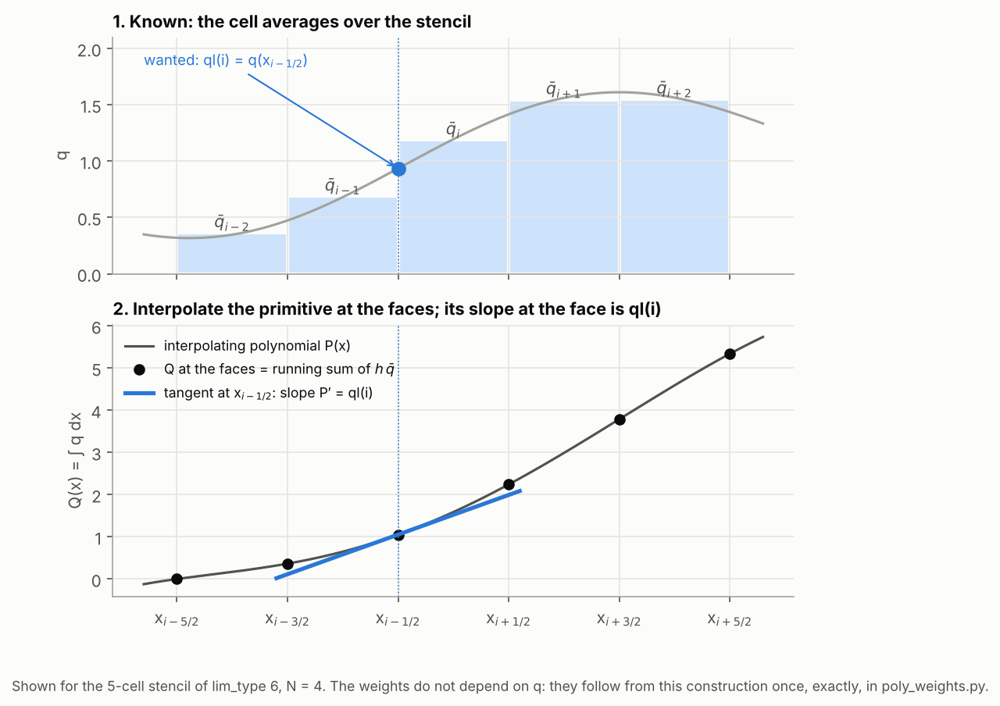
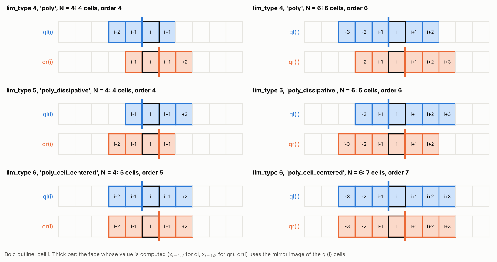
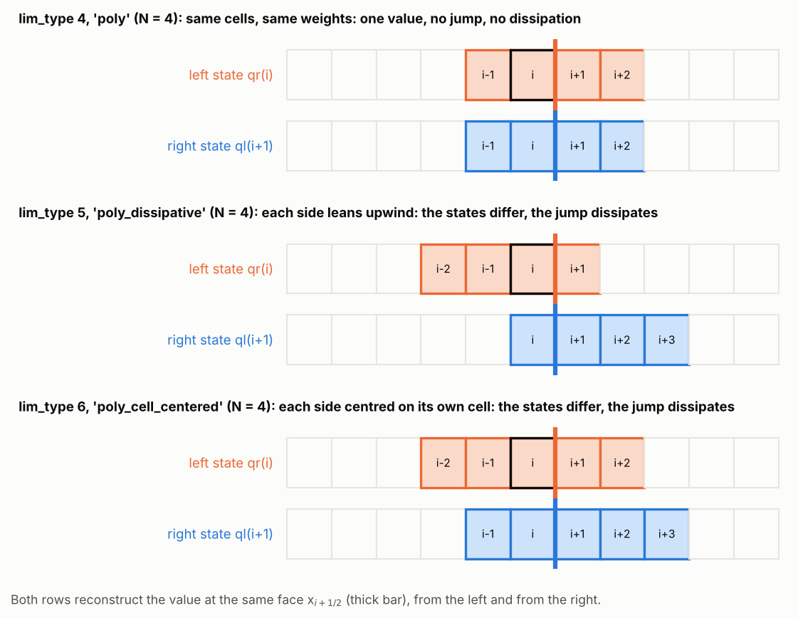
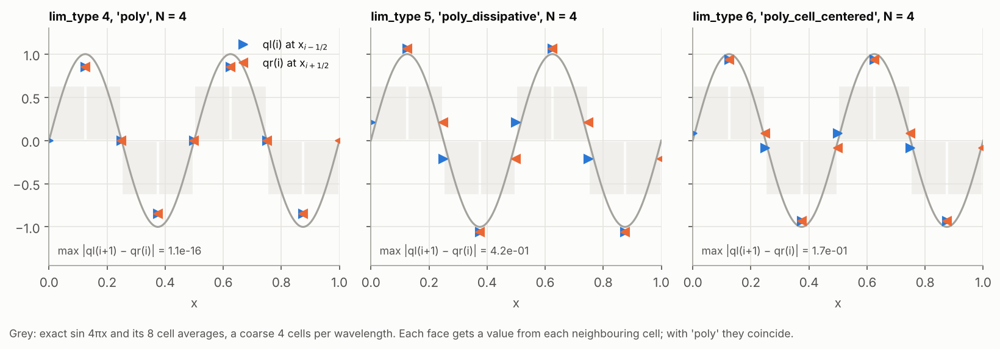
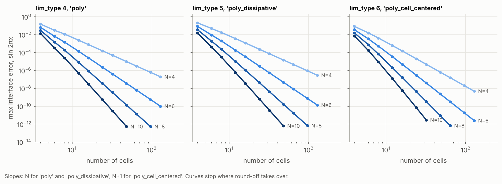
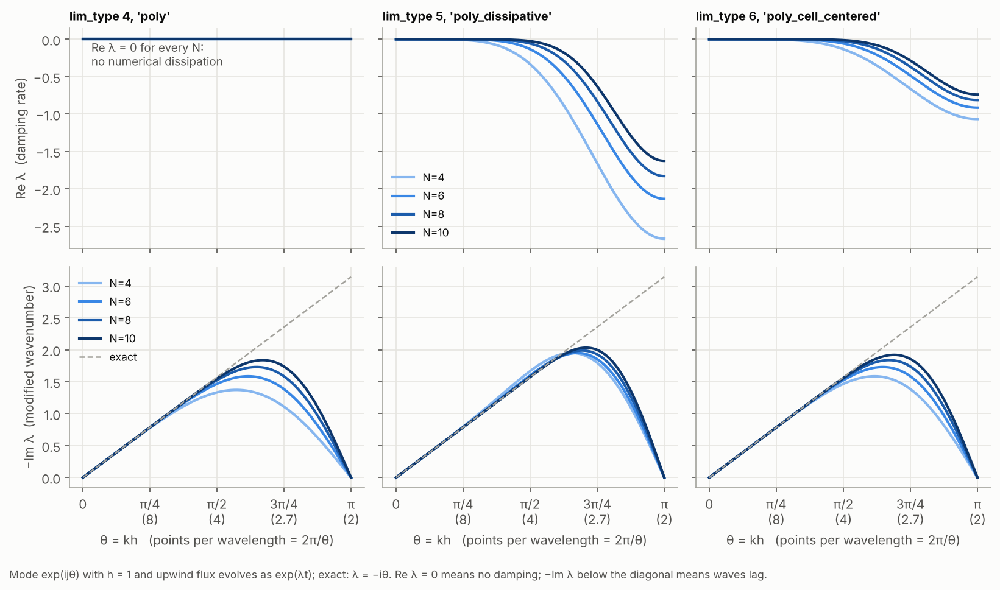

# Polynomial reconstructions in SharpClaw

SharpClaw offers three linear polynomial reconstructions alongside WENO, selected with `solver.lim_type` (4, 5 or 6). They were written for electromagnetic wave problems, where an option that adds no numerical dissipation is valuable. This note explains what they compute, which cells they use, how accurate they are and how they damp and disperse waves. Everything shown here is regenerated by the scripts in this directory.

| `lim_type` | name | cells per face value | formal order | numerical dissipation |
|---|---|---|---|---|
| 4 | `'poly'` | N, centred on the face | N | none |
| 5 | `'poly_dissipative'` | N, shifted one cell upwind | N | strongest |
| 6 | `'poly_cell_centered'` | N+1, centred on the cell | N+1 | moderate |

N is `solver.reconstruction_order`, an even number in {4, 6, 8, 10}.

## 1. What a reconstruction computes

PyClaw is a finite-volume code: `q[i]` holds the **average** of the solution over cell $i$,

$$\bar q_i = \frac{1}{h}\int_{x_{i-1/2}}^{x_{i+1/2}} q(x)\,dx .$$

At every step SharpClaw needs the solution **at the faces**. For each cell the reconstruction returns two values: `ql(i)`, the value at its left face $x_{i-1/2}$, and `qr(i)`, the value at its right face $x_{i+1/2}$. Face $x_{i+1/2}$ therefore receives two values, `qr(i)` from the left and `ql(i+1)` from the right, and the Riemann solver resolves the jump between them. That jump is where the upwinding, and so the numerical dissipation, comes from. Nothing computes values at cell centres.

All three reconstructions are linear combinations of nearby averages with fixed weights:

$$\texttt{ql}(i) = \sum_j w_j\,\bar q_{i+j}, \qquad \texttt{qr}(i) = \sum_j w_j\,\bar q_{i-j}.$$

## 2. Why the averages must be treated as averages

An average is not the value at the cell centre. For smooth $q$, $\bar q_i = q(x_i) + \tfrac{h^2}{24}q''(x_i) + O(h^4)$. Weights that interpolate point values (Lagrange interpolation through the centres) inherit that $O(h^2)$ error, whatever the stencil width. The first version of `poly.f90` did exactly this, and every order converged at second order:



## 3. How the weights are built

The primitive function $Q(x)=\int_{x_0}^{x} q\,dx$ is known **exactly** at every face: it is a running sum of $h\,\bar q$. Interpolate $Q$ at the faces of the stencil with a polynomial $P$, and the face value is the slope $P'$ at that face. The weights do not depend on $q$, so this is done once, in exact rational arithmetic, by `poly_weights.py`:



## 4. Which cells each type uses

With $k = N/2$, the cells used for `ql(i)` are

| type | cells for `ql(i)` | cells for `qr(i)` | idea |
|---|---|---|---|
| `'poly'` | $i-k \dots i+k-1$ | $i-k+1 \dots i+k$ | N cells centred on the face |
| `'poly_dissipative'` | $i-k+1 \dots i+k$ | $i-k \dots i+k-1$ | the `'poly'` stencil shifted one cell upwind |
| `'poly_cell_centered'` | $i-k \dots i+k$ | $i-k \dots i+k$ | N+1 cells centred on cell $i$ |



The difference that matters is what the two sides of one face see. With `'poly'`, `qr(i)` and `ql(i+1)` use the same cells with the same weights, so they are the same number: the Riemann solver sees no jump and adds no dissipation. The other two types reconstruct each side from a different stencil, so the states differ by $O(h^{N})$ (or $O(h^{N+1})$) and the jump is damped.



Every type reaches $k$ cells from the cell being reconstructed, so SharpClaw sets `num_ghost = N/2 + 1` automatically.

### Weights

Generated by `python poly_weights.py --table`; `qr(i)` uses the mirror image ($w_j$ applied to $\bar q_{i-j}$).

**lim_type = 4, `'poly'`**

| N | order | cells for `ql(i)` | weights |
|---|---|---|---|
| 4 | 4 | i-2 … i+1 | (-1, 7, 7, -1) / 12 |
| 6 | 6 | i-3 … i+2 | (1, -8, 37, 37, -8, 1) / 60 |
| 8 | 8 | i-4 … i+3 | (-3, 29, -139, 533, 533, -139, 29, -3) / 840 |
| 10 | 10 | i-5 … i+4 | (2, -23, 127, -473, 1627, 1627, -473, 127, -23, 2) / 2520 |

**lim_type = 5, `'poly_dissipative'`**

| N | order | cells for `ql(i)` | weights |
|---|---|---|---|
| 4 | 4 | i-1 … i+2 | (3, 13, -5, 1) / 12 |
| 6 | 6 | i-2 … i+3 | (-2, 22, 57, -23, 7, -1) / 60 |
| 8 | 8 | i-3 … i+4 | (5, -55, 365, 743, -307, 113, -27, 3) / 840 |
| 10 | 10 | i-4 … i+5 | (-3, 37, -233, 1207, 2131, -893, 367, -113, 22, -2) / 2520 |

**lim_type = 6, `'poly_cell_centered'`**

| N | order | cells for `ql(i)` | weights |
|---|---|---|---|
| 4 | 5 | i-2 … i+2 | (-3, 27, 47, -13, 2) / 60 |
| 6 | 7 | i-3 … i+3 | (4, -38, 214, 319, -101, 25, -3) / 420 |
| 8 | 9 | i-4 … i+4 | (-5, 55, -305, 1375, 1879, -641, 199, -41, 4) / 2520 |
| 10 | 11 | i-5 … i+5 | (12, -153, 947, -4003, 15797, 20417, -7303, 2597, -703, 122, -10) / 27720 |

Two checks on these numbers: `'poly'` with N = 4 is the classical fourth-order face value (-1, 7, 7, -1)/12, and `'poly_cell_centered'` with N = 4 gives exactly the ideal (linear) weights of WENO5.

## 5. Accuracy

`sine_reconstruction.py` reconstructs $\sin 2\pi x$ from its exact cell averages and compares the face values with the exact ones. At a coarse 4 cells per wavelength the difference between the types is visible: all three are close to the curve, but only `'poly'` gives each face a single value.



Errors fall at the formal order until they reach round-off:



Measured with 16 → 32 cells (`python sine_reconstruction.py`):

| type | N = 4 | N = 6 | N = 8 | N = 10 |
|---|---|---|---|---|
| `'poly'` | 3.98 | 5.97 | 7.95 | 9.94 |
| `'poly_dissipative'` | 3.98 | 5.97 | 7.95 | 9.94 |
| `'poly_cell_centered'` | 4.96 | 6.94 | 8.93 | 10.92 |

In the full solver the observed order is also limited by the time integrator: the default `'SSP104'` is fourth order, so for N > 4 the time error dominates unless the CFL number is reduced.

## 6. Dissipation and dispersion

For the model problem $u_t + u_x = 0$ with the upwind flux, the semi-discrete scheme evolves a Fourier mode $e^{ij\theta}$ ($\theta = kh$) as $e^{\lambda t}$; the exact value is $\lambda = -i\theta/h$. $\mathrm{Re}\,\lambda$ is the damping rate and $-\mathrm{Im}\,\lambda$ the modified wavenumber (below the diagonal, waves travel too slowly).



The same data at a few resolutions, as phase-speed ratio $-\mathrm{Im}\,\lambda/\theta$ (1 is exact) and damping rate $\mathrm{Re}\,\lambda$ (with $h = 1$):

| points per wavelength | `'poly'` N=4 | `'poly'` N=8 | `'poly_dissipative'` N=4 | `'poly_dissipative'` N=8 | `'poly_cell_centered'` N=4 | `'poly_cell_centered'` N=8 |
|---|---|---|---|---|---|---|
| 16 | 0.9992 / 0 | 1.0000 / 0 | 1.0011 / -0.000 | 1.0000 / -0.000 | 1.0000 / -0.000 | 1.0000 / -0.000 |
| 8 | 0.9882 / 0 | 0.9998 / 0 | 1.0140 / -0.008 | 1.0002 / -0.000 | 0.9985 / -0.003 | 1.0000 / -0.000 |
| 6 | 0.9648 / 0 | 0.9983 / 0 | 1.0337 / -0.042 | 1.0013 / -0.002 | 0.9924 / -0.017 | 0.9996 / -0.001 |
| 4 | 0.8488 / 0 | 0.9701 / 0 | 1.0610 / -0.333 | 1.0065 / -0.057 | 0.9337 / -0.133 | 0.9863 / -0.025 |

What this means in practice:

- **`'poly'` does not damp anything.** $\mathrm{Re}\,\lambda = 0$ for every wavenumber, so for linear, constant-coefficient problems the semi-discrete scheme conserves the discrete $L^2$ energy; only the time integrator dissipates (slightly). The flip side is that unresolved modes, including grid-scale ($\theta = \pi$) noise, are never damped. Waves lag (phase speed below 1).
- **`'poly_dissipative'` damps most** and its waves run slightly fast (phase speed above 1).
- **`'poly_cell_centered'` damps less** and its waves lag. It has an exact relation to `'poly'`: the average of its two face states is exactly the `'poly'` face value of order N+2. In other words, `'poly_cell_centered'` of order N **is** `'poly'` of order N+2 plus an upwind correction proportional to the jump, which is why their dispersion curves coincide.

## 7. Using them

```python
solver = pyclaw.SharpClawSolver1D(riemann_solver)
solver.lim_type = 'poly'          # or 4; 'poly_dissipative' (5), 'poly_cell_centered' (6)
solver.reconstruction_order = 6   # even: 4, 6, 8 or 10
```

The example `setup()` functions take the same two keywords:

```python
claw = acoustics_1d.setup(solver_type='sharpclaw', lim_type='poly', reconstruction_order=6)
```

`reconstruction_order` is the keyword to use; it is the one that will remain. `solver.lim_type` also accepts `'godunov'` (-1), `'tvd'` (1), `'weno'` (2) and `'weno5'` (3).

For compatibility, `weno_order` and `poly_order` still work, both as solver attributes and as `setup()` keywords. Setting one sets `reconstruction_order` and issues a `FutureWarning`: future releases may deprecate them. `poly_order` switches to `lim_type` 4 unless a polynomial type is already selected; `weno_order` switches a polynomial type to `lim_type` 2 and, as it always did, leaves TVD and Godunov solvers alone. Reading them is silent: `poly_order` returns the order of a polynomial type, or None; `weno_order` returns the order for every other type, or None for a polynomial one.

Limitations:

- **No limiting.** At discontinuities the reconstructions produce Gibbs oscillations; they are meant for smooth solutions.
- **Fortran kernels only**, applied component-wise (`char_decomp` is ignored). They work in 1D, 2D and 3D, since the 2D and 3D solvers apply the 1D reconstruction along each direction.
- **Energy conservation** of `'poly'` is shown here only for linear, constant-coefficient problems; with variable coefficients (e.g. material interfaces stored in `aux`) it is not guaranteed and should be checked for the problem at hand.

## 8. Files and how to regenerate everything

| file | purpose |
|---|---|
| `poly_weights.py` | exact weights, Fourier symbols, and the generator of `src/pyclaw/sharpclaw/poly.f90` |
| `sine_reconstruction.py` | the sine example; `--cells N` sets the grid, `--fortran` compares with the compiled code |
| `test_poly_reconstruction.py` | toy tests (run with `python -m pytest` in this directory) |
| `make_figures.py` | regenerates `figures/*.png` (NumPy and matplotlib only) |

```bash
cd development/poly_reconstruction
python poly_weights.py --check     # is poly.f90 up to date?
python poly_weights.py --write     # regenerate it after changing the stencils
python sine_reconstruction.py      # error and observed-order table
python -m pytest                   # toy tests
python make_figures.py             # rebuild the figures (run by hand)
```

CI does not run anything in `development/`, but `src/pyclaw/tests/test_sharpclaw_poly.py` checks that `poly.f90` matches this generator and that the compiled weights equal the exact ones, so the two cannot drift apart unnoticed.
